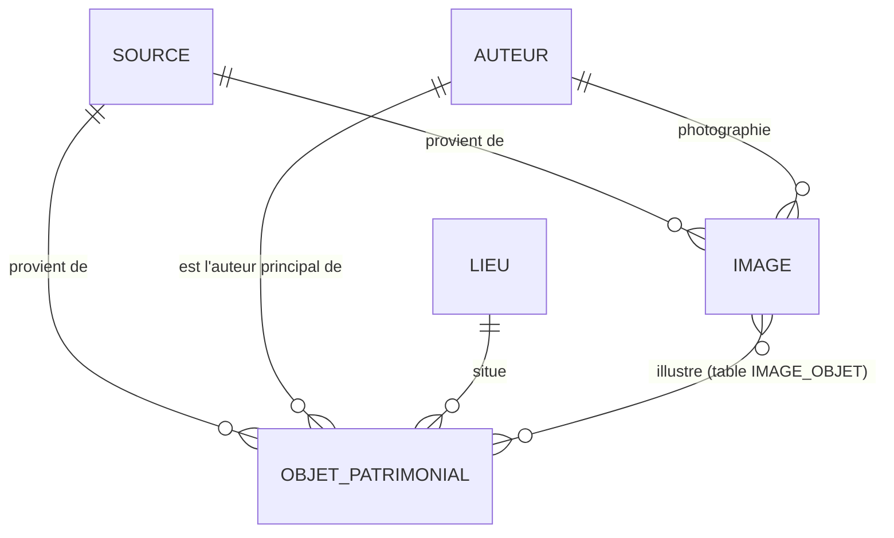

# Intégration et harmonisation de données patrimoniales

## Objectifs
Prendre des inventaires de collections de formats et structures différents, les nettoyer, les harmoniser et les charger dans une base PostgreSQL commune.

Le projet reprend, à petite échelle, le type de travail d'une infrastructure de données pour le patrimoine : diagnostiquer des sources hétérogènes, définir un modèle commun, transformer les données en gardant la trace de chaque étape, contrôler la qualité et documenter.

## Sources de données
 
| Source | Format | Contenu | Utilisé | Lien | Téléchargé le |
|---|---|---|---|---|---|
| Joconde (collections des musées de France) | xlsx | Objets de musées | Extrait de 4 922 notices, toutes de Troyes (musée des beaux-arts et d'archéologie : 4 471 ; musée d'Art moderne : 451) | https://www.data.gouv.fr/datasets/collections-des-musees-de-france-base-joconde-de-troyes-champagne-metropole | 10/11/2026 |
| Palissy MH (liste des objets protégés au titre des Monuments historiques) | csv | Objets protégés, toute la France | 24 995 notices du Grand Est, sur 296 299 | 'https://www.data.gouv.fr/datasets/liste-des-objets-mobiliers-propriete-publique-classes-au-titre-des-monuments-historiques-1 | 10/11/2026 |
| Mémoire illustration Mérimée et Palissy | csv | Métadonnées de photographies (1 308 330 lignes) | Téléchargée et explorée, **non intégrée** (voir « Suites possibles ») | https://www.data.gouv.fr/datasets/memoire-illustration-merimee-et-palissy-monuments-historiques | 10/11/2026 |

## Modèle de données
 

 
Les objets de Joconde et de Palissy sont dans **une seule table**, avec la source et la référence d'origine. Les tables `IMAGE` et `IMAGE_OBJET` sont créées mais pas encore remplies.
 
Principes du modèle :
 
- **Texte d'origine conservé** à côté de la valeur normalisée (`auteur_source`, `date_source`, `materiaux_source`) : on peut toujours vérifier une transformation.
- **Un auteur principal par objet** (le premier cité), le texte complet reste dans `auteur_source`.
- **Les dates** sont gardées en texte et traduites en `annee_debut` et `annee_fin`.
Le schéma complet est dans [`sql/model.sql`](sql/model.sql).
 
## Structure du dépôt
 
```
data/raw/        fichiers d'origine jamais modifiés
data/interim/    résultats intermédiaires (Palissy filtré sur le Grand Est)
notebooks/       01 exploration, 02 filtrage
src/             scripts du pipeline
sql/             modèle de la base et requêtes de contrôle
reports/         listes de cas non traités et résultats des contrôles
docs/            plan de correspondance des colonnes
```
 
## Installation
 
```bash
python -m venv .venv
source .venv/Scripts/activate        # Windows (Git Bash) ; Linux : .venv/bin/activate
pip install -r requirements.txt
```
 
PostgreSQL 18 (version utilisée : 18.7).
 
## Exécution
 
```bash
# 1. Base et tables
createdb -U postgres patrimoine
psql -U postgres -d patrimoine -v ON_ERROR_STOP=1 -f sql/model.sql
 
# 2. Table SOURCE : une ligne par source (nom, format, url, date de téléchargement)
psql -U postgres -d patrimoine -c "
INSERT INTO source (nom, format, url, date_telechargement) VALUES
 ('Joconde', 'xlsx', 'https://www.data.gouv.fr/datasets/collections-des-musees-de-france-base-joconde-de-troyes-champagne-metropole', '2026-11-10'),
 ('Palissy MH', 'csv', 'https://www.data.gouv.fr/datasets/liste-des-objets-mobiliers-propriete-publique-classes-au-titre-des-monuments-historiques-1', '2026-11-10'),
 ('Mémoire illustration', 'csv', 'https://www.data.gouv.fr/datasets/memoire-illustration-merimee-et-palissy-monuments-historiques', '2026-11-10');"
 
# 3. Filtrage de Palissy sur le Grand Est : notebooks/02_filtrage.ipynb
 
# 4. Chargement
python src/charger_lieux.py
python src/charger_auteurs.py
python src/charger_objets.py
 
# 5. Contrôles de qualité
psql -U postgres -d patrimoine -f sql/controles.sql -o reports/controles_resultats.txt
```
 
## Méthode
 
1. **Exploration** (`notebooks/01_exploration.ipynb`) : dimensions, colonnes vides, identifiants uniques, valeurs fréquentes.
2. **Plan de correspondance** (`docs/correspondances.md`) : pour chaque colonne du modèle, la colonne source et la transformation.
3. **Transformation et chargement** (`src/`) : les fonctions de nettoyage sont réunies dans `src/nettoyage.py`.
4. **Contrôles** (`sql/controles.sql`) : questions posées à la base pour vérifier qu'elle est cohérente.
## Règles de nettoyage
 
| Domaine | Règle |
|---|---|
| Lieux | Palissy sert de référence (commune, département, région, code INSEE). Les communes de Joconde sont retrouvées avec une clé de rapprochement sans accents, majuscules ni ponctuation. |
| Codes INSEE | Zéro initial restitué. Code actuel retenu s'il existe, sinon ancien code. Les codes invalides (`670004`, `ETRANGER`) sont rejetés. |
| Auteurs | Premier auteur cité. Dates entre parenthèses extraites. Rôles et mentions (« attribué », « fondeur ») retirés du nom. Format « Nom, Prénom » ramené à « Nom Prénom ». « anonyme » et « auteur inconnu » deviennent une seule ligne `anonyme`. Une même personne écrite avec une autre casse est regroupée. |
| Dates | `17e siècle` = 1601-1700 ; `1er quart 20e siècle` = 1901-1925 ; `2e moitié 19e siècle` = 1851-1900 ; plusieurs valeurs : du plus petit début au plus grand fin. Choix d'interprétation : `milieu 18e siècle` = 1741-1760 ; `limite 18e siècle 19e siècle` = 1791-1810 ; la mention `(?)` est ignorée. |
| Domaines | Les listes (`['peinture']` chez Joconde, `["peinture"]` chez Palissy) sont lues et réécrites en `a ; b`. |
 
## Résultats
 
| Mesure | Joconde | Palissy (Grand Est) |
|---|---|---|
| Objets chargés | 4 922 | 24 995 |
| Objets avec un auteur renseigné | 4 798 (97 %) | 9 613 (38 %) |
| dont auteur anonyme | 1 065 (22 %) | 4 763 (50 %) |
| Objets rattachés à un lieu | 4 922 | 24 993 |
| Objets avec des années de début et de fin | 4 896 (99,5 %) | [à compléter après la dernière exécution] |
| Textes de date non compris | 0 | [à compléter] |
 
Total : **29 917 objets**, **3 077 lieux** (dont 1 sans code INSEE valide), **2 985 auteurs** (dont 131 avec dates).
 
Le regroupement des variantes d'écriture se voit dans les décomptes d'auteurs. Dans Joconde, `GAUSSEN Alfred` passe de 92 à 110 objets, `LANCELOT Gustave` de 99 à 140 et `Dubois Paul` de 302 à 307.
 
La lecture des dates a été améliorée en deux passes. Première passe : [à compléter] textes non compris (2 183 objets de Palissy). Seconde passe, avec les formes « milieu », « limite » et « (?) » : [à compléter].
 
Détail des contrôles : `reports/controles_resultats.txt`.
 
## Constats de qualité
 
| Source | Constat | Décision |
|---|---|---|
| Joconde | 14 colonnes entièrement vides, 9 autres vides à plus de 95 % | Non reprises |
| Joconde | `date_creati` contient la date de la notice, pas celle de l'objet | `periode_de__1` utilisée |
| Joconde | Titres tantôt en majuscules, tantôt en minuscules | Conservés tels quels |
| Palissy | 150 notices sans région | Exclues du filtre Grand Est |
| Palissy | 3 codes INSEE invalides (`670004`, `ETRANGER` deux fois) | Rejetés |
| Palissy | 2 objets sans nom de commune (PM10004948, PM52001686) | Sans lieu (`id_lieu` vide) |
| Palissy | 947 objets avec une liste de domaines vide | Domaine laissé vide |
| Les deux | Vocabulaires de domaines différents : seuls « peinture » et « sculpture » sont communs | Conservés tels quels |
| Les deux | 103 objets avec une période de plus de 300 ans | Années calculées, siècle approximatif |
| Palissy | 19 noms d'auteurs de formes particulières (alias, variantes, deux personnes collées) | Listés dans `reports/auteurs_a_verifier.csv` |
 
## Limites
 
- L'extrait Joconde ne couvre qu'une commune. Le rapprochement des lieux est surtout exercé sur Palissy.
- Un seul auteur par objet : environ 13 % des objets de Joconde et 12 % de ceux de Palissy en ont plusieurs. Le texte complet est conservé. Une table de liaison `OBJET_AUTEUR` serait l'évolution naturelle.
- Deux écritures très différentes d'une même personne ne sont pas fusionnées, et deux personnes homonymes le sont. La mention « attribué » disparaît du nom normalisé (elle reste dans `auteur_source`).
- Les entreprises (par exemple `Bugatti`) sont traitées comme des auteurs.
- La région dépend du département : elle est stockée dans `lieu` sans table séparée, ce qui est un choix de simplification.
- Les domaines ne sont pas harmonisés entre les deux sources : il faudrait une table de correspondance.
